<div align="center">


# ARTEX-IOT

本项目基于 [ARTEX-God](https://github.com/Xiao1an/ARTEX-God) 二开，感谢原作者的开源。

重心放在 **IoT 固件审计**：移除了面向公网资产的探测与扫描渗透，把“资产”换成“组件”——围绕固件里一个个可指认的组件（httpd、busybox、upnpd、MQTT 服务……）去做解包、逆向、漏洞验证与复现。

**支持：固件解包 · 二进制逆向（IDA 无头反编译，Web 端直接读函数源码）· PoC 生成与复现（可录屏）· 组件级漏洞挖掘与覆盖度追踪。**

反编译导出的前提是 **IDA 9.0+**（提供无头 `idat`）与 **INP.py**。IDA 出于版权考虑请自行安装，只要保证 9.0 及以上；INP 插件来源于开源项目 IDA-NO-MCP，但本项目的 `INP.py` 有改动，**请使用仓库根目录的这一份**。

把 `INP.py` 放到 IDA 安装目录的 `plugins/` 下，然后在「系统配置 → 反编译」里填写 IDA 安装目录（或设置环境变量 `ARTEX_IDA_DIR`，也可以把 `idat` 加进 `PATH`）。

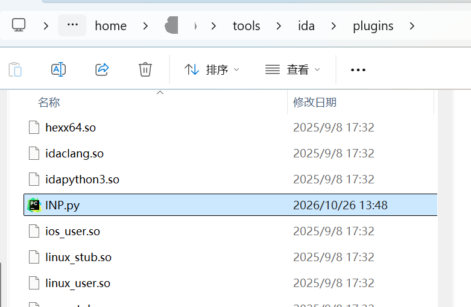

</div>

---

## 截图预览

> 完整交互见[在线 Demo](https://artex-demo.vercel.app/)。

| 仪表盘（总览 / Token 消耗 / 活动流） | 任务列表 |
| :---: | :---: |
| 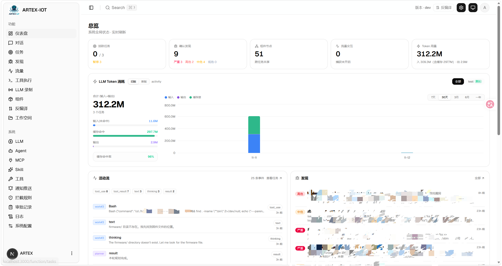 | 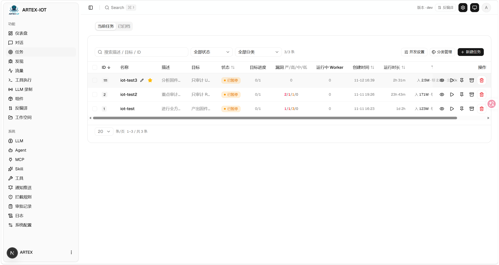 |

| 任务 · 执行过程（会话 / 工具调用） | 探索链路 |
| :---: | :---: |
| 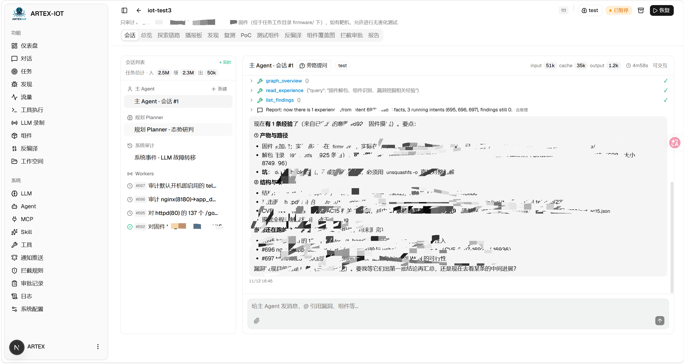 | 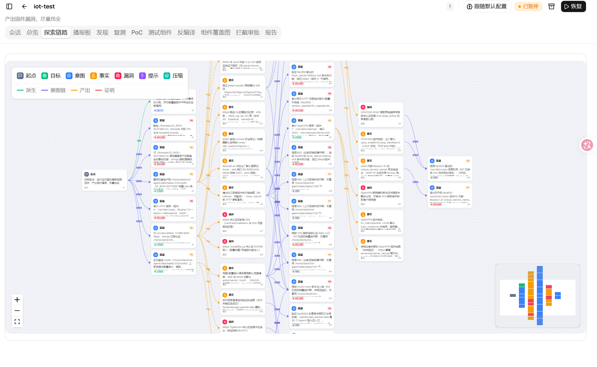 |

| 发现（漏洞） | 组件库（组件版本 / 固件版本 / 厂商） |
| :---: | :---: |
| 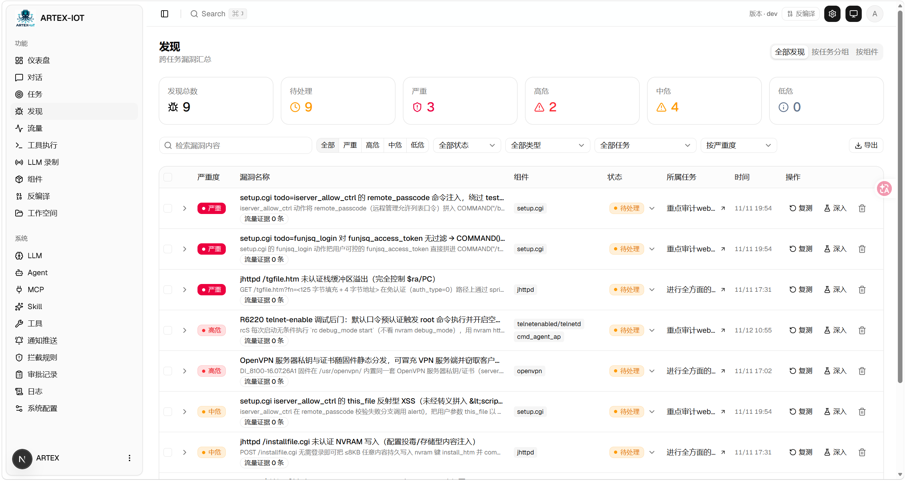 | 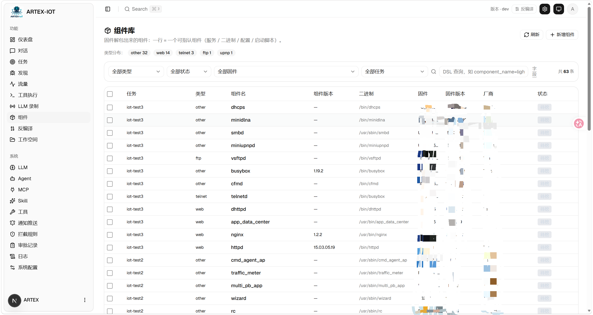 |

| 反编译（函数列表 + 源码） | 人在环路对话 |
| :---: | :---: |
| 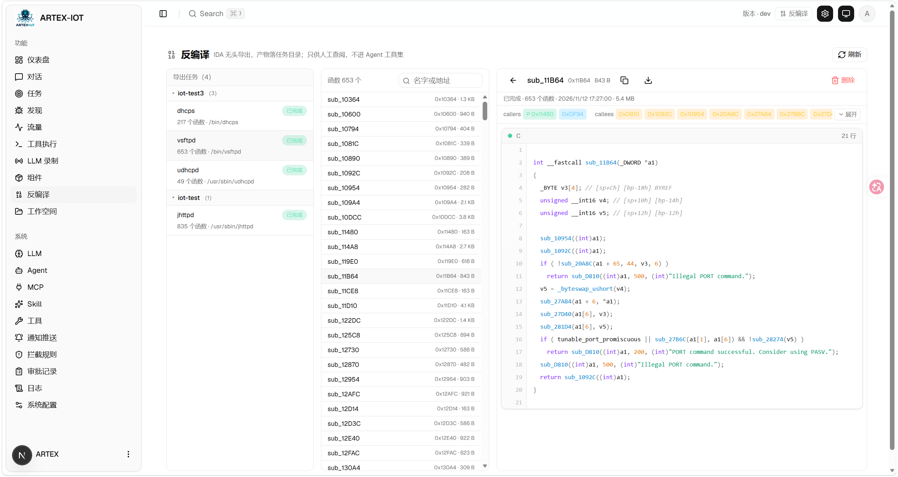 | 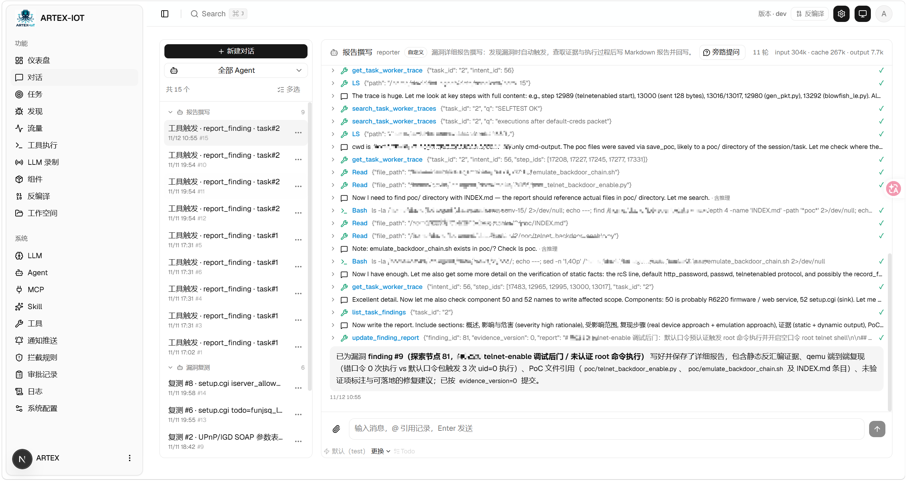 |

| Agent 管理 | LLM 配置 |
| :---: | :---: |
| 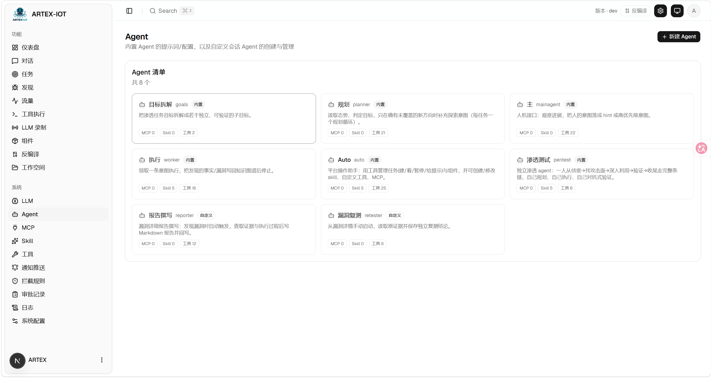 | 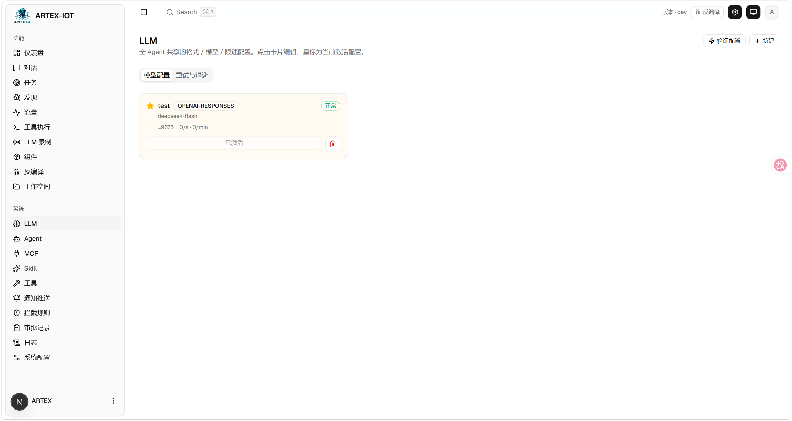 |

| 拦截审批 | 后端日志 |
| :---: | :---: |
| 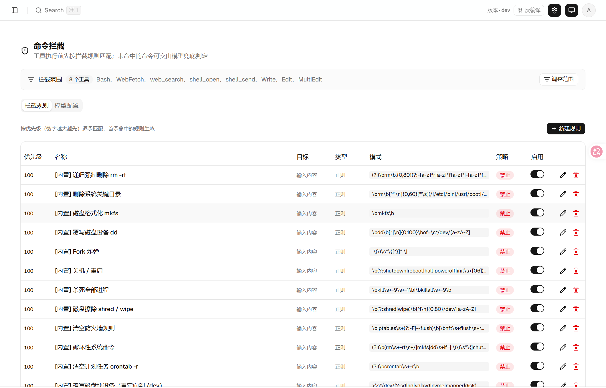 | 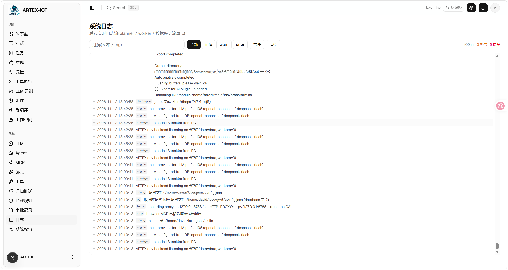 |


---

## 本分支相对上游的主要改动

- **方向收敛到 IoT 固件**：去掉资产探测与公网扫描渗透，工作单元从“资产”改为“组件”，覆盖度、漏洞、复测都围绕组件展开。
- **固件厂商 / 版本人工可覆盖并锁定**：按 sha256 全局唯一，人改一次全库同步，Agent 只能补空（见下文「固件厂商与版本」）。
- **IDA 无头反编译**：任务内「反编译」页签 + 跨任务「反编译」页，`idat` 逐个二进制导出 `.c`，Web 端函数搜索、callers/callees 跳转（见下文「IDA 无头反编译」）。
- **组件库表格重做**：列序按审计习惯重排（任务/类型/组件名/组件版本/二进制/固件/固件版本/厂商/状态），列宽可拖拽、超宽省略、按任务筛选 + DSL 查询。
- **固件上传不再静默失败**：上传失败会阻断建任务并给出原因，事后可在任务详情补传。
- **品牌与资产**：更名 ARTEX-IOT，logo、favicon、应用图标统一替换。

## 审批记录

全局「审批记录」、任务内「拦截审批」以及对话里的审批卡片都支持展开查看详情（命令、参数、命中规则与放行理由），展示结构参考 [AegisHook 的审批详情组件](https://github.com/RuoJi6/AegisHook/blob/main/web/src/components/CallDetail.vue)，配色与组件沿用 ARTEX 主题。

## 安装

> 依赖数据库 **PostgreSQL**；探索需配置 **LLM**（`ANTHROPIC_API_KEY` 或 `OPENAI_API_KEY`，也可在 UI 里配）。

### 方式一：一键安装脚本（推荐）

```bash
# 本项目是 ARTEX-God 的 IoT 分支，克隆地址换成你自己的仓库
git clone <本仓库地址> ARTEX-IOT
cd ARTEX-IOT
./install.sh
```

脚本会引导你填写数据库连接（PostgreSQL）→ 生成 `config.json` → 用 `go` 编译内嵌前端的单二进制 → 启动。

装好后打开 **http://localhost:8787**（首次进入 `/setup` 设置管理员密码）。

远程 MCP 可在系统设置中选择 `http`（Streamable HTTP）或 `sse`（旧版 SSE）。
旧版 SSE 服务通常使用 `GET /sse` 建立事件流，再通过服务返回的
`/message?sessionId=...` 接收 JSON-RPC 请求；配置时将 URL 填为 `/sse`，请求头按
`Authorization=Bearer <token>` 填写。

### 方式二：下载预编译二进制（Releases）

到 [Releases](https://github.com/Xiao1an/ARTEX-God/releases) 下载对应平台的 zip，解压后得到 `artex` + `start.sh`（Windows 为 `start.bat`）+ `skills/` + `config.example.json`：

```bash
cp config.example.json config.json   # 填好 database 连接
./start.sh                           # → http://localhost:8787
```

> 请用 `start.sh` / `start.bat` 启动，而不是直接跑 `./artex`。它是个守护脚本：程序退出后按退出码决定是否重新拉起，**页面上的[一键更新](#方式一页面一键更新推荐)靠它完成换装**。直接运行 `./artex` 时更新完就不会被拉起了。
> 后台常驻：`nohup ./start.sh >artex.log 2>&1 &`。

### 方式三：从源码编译单二进制

```bash
# 1) 前端静态导出
cd web && npm ci && npm run build:static && cd ..
# 2) 拷进内嵌目录
cp -r web/out server/webui/dist
# 3) 编译（-tags embedui 才内嵌前端）
CGO_ENABLED=0 go build -tags embedui -o artex ./cmd/artex
./start.sh
```

### 方式四：构建跨平台 Release 压缩包

`build.sh` 会先构建并嵌入前端，再使用 Go linker 去除调试信息，并将发布文件压缩为 zip。Release 模式默认生成 Linux amd64/arm64、macOS amd64/arm64 和 Windows amd64 的 zip 包：

```bash
./build.sh --release
# 产物：dist/artex-0.3.3-*.zip
```

UPX 自解压二进制可能与部分 Linux 内核、虚拟化环境或安全策略不兼容，因此默认不启用。可用 `ARTEX_TARGETS` 自定义目标；确认目标运行环境兼容时，可显式传入 `--upx` 进一步缩小二进制：

```bash
ARTEX_TARGETS=linux/amd64,windows/amd64 ./build.sh --release
./build.sh --target linux/amd64 --upx
```

---

## 更新升级

> 升级只换程序、不动数据：`./data`（jwt.key / SQLite 等）、`./skills` 与你的 PostgreSQL 都会保留。**数据库迁移无需手动执行**——`artex` 每次启动会幂等重跑 `schema.sql`（含 `ADD COLUMN` / `CREATE INDEX IF NOT EXISTS`），即“重启即迁移”。升级前仍建议先备份 `./data` 与数据库。

### 本仓库的私有 Release 更新源

更新源目前在代码里写死为上游 [Xiao1an/ARTEX-God Releases](https://github.com/Xiao1an/ARTEX-God/releases)（`selfupdate/github.go` 的 `const Repo`），Go module 路径也沿用上游。本分支若发布自己的 Release，需要先改这一行（或后续加环境变量覆盖），否则「检查更新」会拿上游版本号与本项目比较。

若仓库为私有，请为运行 ARTEX 的后端进程设置 `ARTEX_UPDATE_GITHUB_TOKEN`，令牌只需本仓库的 **Contents: read** 权限。令牌由后端用于查询 Release 和下载附件，不发送给浏览器，也不要提交到 Git。公开仓库则无需令牌。

```bash
# 先在当前 shell 或服务环境中安全设置 ARTEX_UPDATE_GITHUB_TOKEN
./start.sh
```

如需配置更新令牌（仅私有仓库），把 `ARTEX_UPDATE_GITHUB_TOKEN` 导出到运行 artex 的进程环境即可。

需要先在本仓库发布非 draft、非 prerelease 的正式 Release，并附上 `artex-<版本>-<os>-<arch>.zip` 和 `SHA256SUMS`，页面才能提供可安装更新。仓库里只有源码时还不能在线升级。现有 Release 工作流会在推送 `v*` tag 时为当前仓库生成这些附件。

### 方式一：页面一键更新（推荐）

在 **系统配置** 页（侧边栏「系统配置」→ `/system/settings`）的**版本与更新**卡片里，可以直接检查并安装新版本，无需登录服务器。

点「更新」后：下载当前平台的发布包 → 比对 Release 的 `SHA256SUMS` → 用 `-h` 冒烟测试新二进制 → 暂存为 `artex.new` → 程序退出，由 `start.sh` / `start.bat` 重新拉起并完成换装。页面会自动等到新版本上线后刷新。

- **失败不会留下坏程序**：校验或冒烟不通过就丢弃暂存件、继续跑当前版本；换装后的新版若连续 3 次启动失败，会自动回滚到 `artex.old`（失败的那个留作 `artex.failed` 供排查）。
- **随时可回退**：上一版本保留为 `artex.old`，卡片上有「回滚到上一版本」。注意数据库结构不会回退。
- **更新会中断正在运行的任务**——更新即重启，请在空闲时进行。
- **开发构建不给更新**：版本号是 `dev` 或 `git describe` 带后缀时禁用，避免正式版覆盖掉本地调试的二进制。
- 访问 GitHub 需要代理时，在同一页面配置**全局代理**即可，更新链路会走它。更新只从 GitHub 域名下载并强制 HTTPS。

### 方式二：一键更新脚本

```bash
cd ARTEX-God
./update.sh
```

脚本先可选 `git pull` 拉取最新代码，再重建前端静态产物 → 重新编译 `./artex`（完成后重启进程生效）。

### 方式三：预编译二进制（Releases）

到 [Releases](https://github.com/Xiao1an/ARTEX-God/releases) 下载新版本 zip，停掉旧进程后覆盖 `artex` 与 `skills/`（保留你的 `config.json` 与 `data/`），重启即可：

```bash
cp -r <解压目录>/skills ./ && cp <解压目录>/artex ./
./start.sh
```

### 方式四：从源码编译

```bash
git pull
cd web && npm ci && npm run build:static && cd ..
cp -r web/out server/webui/dist
CGO_ENABLED=0 go build -tags embedui -o artex ./cmd/artex
# 重启 ./start.sh
```

---

## 配置

**数据库**（`config.json`，或用环境变量 `ARTEX_PG_DSN` 覆盖）：

```json
{
  "database": {
    "host": "127.0.0.1", "port": 5432,
    "user": "artex", "password": "yourpass",
    "dbname": "artex", "sslmode": "disable"
  }
}
```

**LLM**：`export ANTHROPIC_API_KEY=sk-...`（或 `OPENAI_API_KEY`），也可在 UI 的「LLM 配置」页填写。
可选：`ARTEX_LLM_PROVIDER` / `ARTEX_LLM_MODEL` / `ARTEX_LLM_BASE_URL` / `ARTEX_LLM_PROXY`。

**并发**：每个任务的 work agent 数在「系统设置」里配置（默认 3）。

**常用参数**：`./start.sh -addr :8787 -proxy :8788`（`-addr` 前端+API，`-proxy` 流量录制代理）。启动脚本会把参数原样透传给 `artex`。

### 反向代理部署（HTTPS / 只开放 443）

前端和 API/SSE 都由同一个后端端口（默认 `:8787`）提供，实时活动流默认走**同源**地址，因此**无需配置 `NEXT_PUBLIC_SSE_BASE`**，公网只开放 443、把 8787 留在内网即可。

SSE 是长连接 + 持续推送，反代**必须关闭缓冲**，否则浏览器能连上却收不到事件（表现为活动流一直转圈）。Nginx 示例：

```nginx
server {
    listen 443 ssl;
    server_name your.domain.com;
    # ssl_certificate / ssl_certificate_key ...

    location / {
        proxy_pass http://127.0.0.1:8787;
        proxy_set_header Host $host;
        proxy_set_header X-Forwarded-Proto $scheme;

        # SSE 关键项：关缓冲、长超时、HTTP/1.1
        proxy_buffering off;
        proxy_cache off;
        proxy_read_timeout 3600s;
        proxy_http_version 1.1;
        proxy_set_header Connection "";
    }
}
```

> 仅当 SSE 需要走与页面不同的来源（如独立子域）时，才在**构建期**设置 `NEXT_PUBLIC_SSE_BASE`（该变量在 `next build` 时固化进静态包，容器运行时再设无效）。

---

## 固件厂商与版本

固件级的「厂商 / 版本」不挂在任务上，而是按**固件内容 sha256** 存一份权威值（落在 `task_scope` 中 `kind='firmware'` 的那一行）：同一个固件在所有任务里只有一份值，写入时按 sha 全量同步，不会出现“这行有值、那行空”的分叉。

- **两个填写入口**：新建任务抽屉里的「固件厂商 / 固件版本」（此刻还没上传固件、没有 sha，先暂存在任务上，上传后自动绑定）；任务详情「测试范围 · 固件」行的「修改」。
- **人填的可以覆盖**：改完该 sha256 的所有记录一起变，来源标记 `manual`。
- **Agent 只能补空**：已有值不会被覆盖（来源标记 `agent`），避免不同 worker 给同一固件写出多个版本。
- **厂商统一规范化**为首字母大写、其余小写（`TENDA` / `tenda` → `Tenda`）。
- **与组件版本区分**：组件自己的 `version / vendor` 是组件属性（`busybox 1.19.2`、`nginx 1.2.2`、厂商自研 httpd …），与固件版本是两套字段，表格里分别显示为「组件版本」和「固件版本」。

组件库表格：**任务 · 类型 · 组件名 · 组件版本 · 二进制 · 固件 · 固件版本 · 厂商 · 状态**。列宽可拖拽、超出列宽省略（悬停看全），支持按任务筛选，以及 DSL 查询（`component_name=lighttpd`、`status==pending AND type==web`、`port>=8000`）。

## IDA 无头反编译

可选能力，依赖本机的 **IDA 9.0+**（`idat`）与仓库根目录的 `INP.py`（放进 IDA 的 `plugins/`）。

- **入口**：任务详情「反编译」页签（只列本任务组件）→ 勾选组件 → 建导出任务；侧边栏「反编译」整页可跨任务查看所有导出任务。
- **配置**：系统配置 → 反编译。IDA 安装目录（留空回退 `ARTEX_IDA_DIR`，再回退 PATH 里的 `idat`）、INP 插件路径（默认 `<ida>/plugins/INP.py`）、单任务超时（默认 1800s）、单次勾选组件上限（默认 8）、任务产物配额（默认 2048 MB）。
- **队列**：每个二进制一个 job，唯一键 `(task_id, binary_sha256)`；并发固定 1（IDA 许可限制）；失败/取消的 job 可重试；程序退出时会终止正在跑的 `idat` 进程组。
- **产物**：`data/tasks/<任务 id>/decompile/<sha 前 8 位>/`，内含 `index.json`（函数名 / 地址 / callers / callees）与每函数一个 `.c`。
- **浏览**：函数搜索、callers/callees 芯片、双击函数名跳转并可一键跳回；代码面板只按 `index.json` 取地址，不做路径拼接。

---

## 开发

### 手动漏洞复测

任务详情的「复测」页签可分页选择本任务的漏洞、查看历次结论和证据，并手动发起复测。启动后保留当前页签，显示转圈图标和「复测中」；确认修复后同步更新漏洞状态。

在漏洞列表每行操作区点击「复测」，或在漏洞详情的「漏洞复测」区域点击「发起复测」，填写可选的修复版本、测试条件或限制，系统会创建独立的复测 Agent 会话，启动后保留当前页面。列表的平铺、按任务分组和资产视图均支持该入口；复测运行时显示转圈图标和「复测中」，需要查看时点击进入对应会话，结束后恢复「复测」。复测无需重新启动原扫描任务，结论分为「仍可复现」「已修复」「无法确认」，每次的结论、证据和会话链接保存在漏洞详情中。

新版后端首次启动会预置可编辑的「漏洞复测」（`retester`）Agent，可在 Agent 管理中配置提示词、LLM、运行预算和工具。默认使用其绑定的 LLM，未绑定则使用全局激活配置。复测会话成功完成且结论为「已修复」时，系统自动将漏洞处置状态改为「已修复」；执行中、失败、停止或其他结论保留原状态。原始证据和报告始终保留。也可在状态下拉菜单中手动选择「已修复」。同一漏洞正在复测时复用已有会话，停止、失败或服务重启后可重新发起。

本版历史记录通过漏洞详情和会话查看，暂未纳入漏洞报告导出或任务归档包，也未自动关联流量包。演示模式只生成明确标注的模拟记录，不请求真实目标。

### 本地运行与测试

```bash
./dev.sh    # 后端(:8787) + 流量代理(:8788) + 前端 next dev(默认 :3000) → http://localhost:3000
```

- 后端：`go run ./cmd/artex`（不带 `-tags embedui` 则不内嵌前端）
- 前端：`cd web && npm run dev`（`/api` 反代到后端，带热更新）
- 测试：`go test ./...`（**务必指向独立测试库**：`ARTEX_PG_DSN=postgres://…/artex_test`，`db` / `server` 的用例会真写库）
- 反编译：先在「系统配置 → 反编译」填 IDA 目录并点「测试」，它会实际解析 `idat` 与 `INP.py`
- Mock 预览（无后端）：`cd web && NEXT_PUBLIC_MOCK=1 npm run dev`

---

## 系统技术架构

ARTEX 是一套 **LLM 多 agent 驱动的固件漏洞挖掘系统**：Go 单体后端（内嵌 Next.js 前端）+ PostgreSQL，agent 能力由 [`norma`](https://github.com/Autumn-27/norma) SDK 提供（`agentcore` / `tool` / `permission` / `harness` / `memory` / `transcript`）。核心是**双图架构**，以及围绕它的两条自主性机制：**worker 间过程级信息交换**与 **planner 多轮共享 todolist 稳定攻击链路**。

### 总体分层

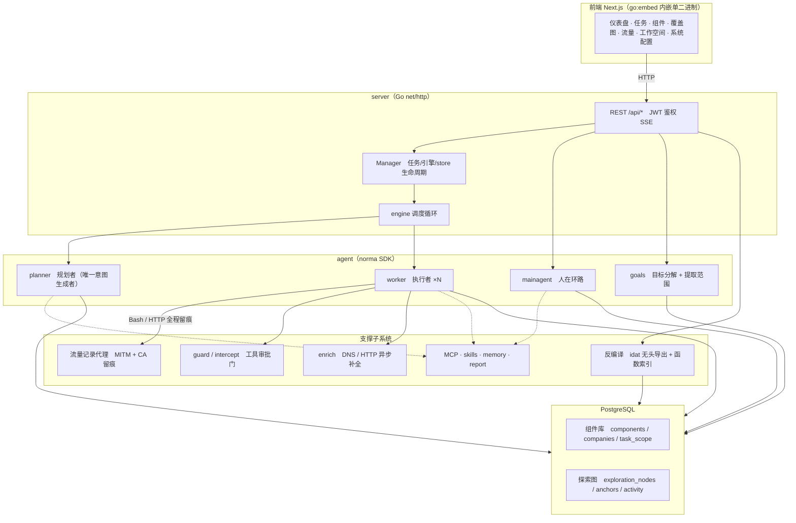

| 层 | 职责 |
| --- | --- |
| **前端** | Next.js 静态导出，`go:embed` 内嵌进单二进制；可视化任务/组件/探索链路/覆盖图，人在环路对话 |
| **server** | `net/http` 路由 + JWT 鉴权 + SSE；`Manager` 托管任务、引擎、DB store 的生命周期 |
| **engine** | 每任务一个 `plannerLoop` + N 个 worker goroutine；意图领取、超时/暂停/drain |
| **agent** | goals / planner / worker / mainagent，`ToolSet` 把双图暴露成 LLM 工具 |
| **db** | 双图的 Postgres 落地（pgx）；schema 随 `go:embed` 每次启动幂等建表 |
| **支撑** | 记录型 MITM 代理、审批门、异步补全、MCP/技能/记忆/报告、`idat` 无头反编译（job 队列 + `index.json` 索引） |

### 双图架构：探索图 + 组件库

系统把「**测什么**」和「**想到哪了**」拆成两份相互独立、又通过锚点相连的数据：

- **组件库（components，全局共享）**：跨任务同一份的组件清单。一行 = 固件里的一个可指认组件（`type / component_name / version / vendor / binary_path / config_path / started_by / port / status`），按 `(firmware_sha256, type, component_name, version)` 去重；`status` 就是挖掘进度（`pending / running / completed / ignored`）。
- **探索图（Exploration Graph，每任务独立）**：一次任务的“思考与推进”过程。节点为 `goal（目标）/ intent（意图）/ fact（事实）/ finding（漏洞）/ hint（提示）`，靠 `spawns / derived_from / yields / proves` 等边连成**血缘链**，回答“哪个方向派生自哪些事实、产出了什么”。
- **固件元信息**：`task_scope` 里 `kind='firmware'` 的那一行不仅有文件名、`sha256` 和解包路径 `extract_path`，还存**固件级的 `vendor / version`**——按 sha 全局唯一，人工可覆盖、Agent 只补空（详见上文「固件厂商与版本」）。
- **两边靠锚点相连**：`exploration_anchors(node_id, component_id)` 把意图/事实/漏洞锚定到具体组件上——于是既能从“探索方向”看它打的是哪些组件，也能从“某个组件”反查它在本任务被哪些意图测过、得出过哪些事实。这也支撑了**组件测试覆盖度**与**组件覆盖图**（组件类型 → 组件两层 + 已测高亮）。

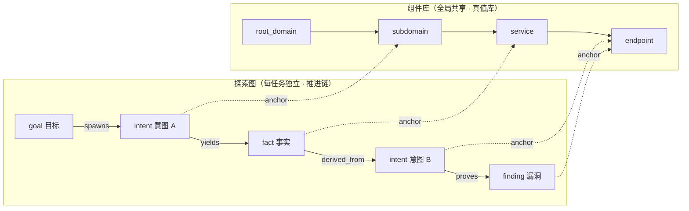

> 分工：**planner** 读探索图态势、判目标、只在有未覆盖的新方向时派**意图**进 frontier；**worker** 领**一条意图**、用真实工具执行、把新组件/事实/漏洞写回两图后即停。组件库是跨任务共享的事实，探索图是每任务的推进链。

### 引擎与意图生命周期（一次探索的闭环）

引擎是**事件驱动**的闭环：图一变就唤醒 planner，planner 派意图，worker 领意图执行并写回，写回又触发下一轮——直到目标被证明（`prove_goal`）。

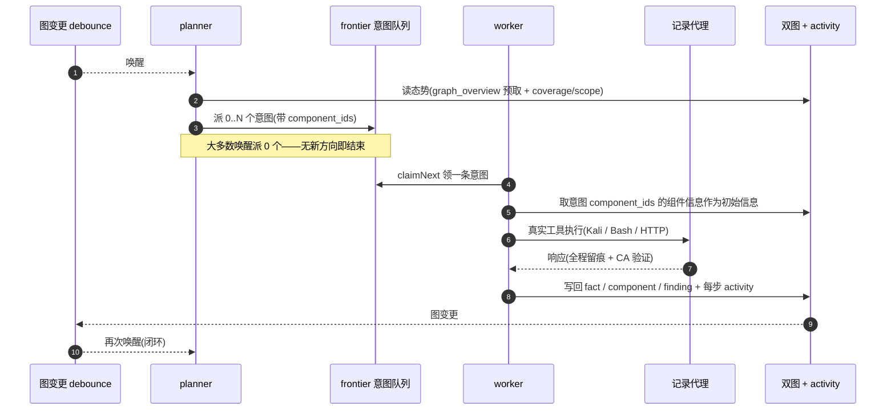

### worker 间的过程级信息交换

一次深入的探索里，很多有价值的观察（某个报错、某段响应、某个隐藏参数）出现在一个 worker 的**执行过程**中，却未必被写成正式 fact。为避免重复劳动、让链路上的 worker 能站在彼此的肩膀上，worker 具备**跨 work 检索过程**的能力：

- `search_all_worker_traces(q)`：在**本任务其他 work 的执行过程**里按关键字检索（自动排除自己这条意图的步骤），命中项带 `intent_id`；
- `list_worker_traces` / `get_worker_trace(intent_id, step_ids=[…])`：先看有哪些 work 跑过，再取某个 work 具体几步的完整内容做细节交换。

这样即便探索图上还没有对应的 fact，后续 worker 也能复用他人过程中的观察——**信息在 worker 之间以“执行过程”为粒度流动**，而边界不变（每个 worker 仍只做自己领到的那条意图）。

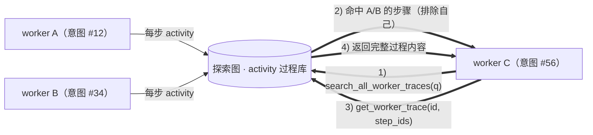

### planner 多轮共享 todolist → 稳定的攻击链路

真实攻击链往往是**有前后依赖的多步序列**（如：发现注入点 → 拿到凭据 → 横向 → 提权），一次性把这些并行派下去只会乱套。planner 因此持有一份**按任务保留、跨唤醒共享的规划待办（todolist）**：

- planner 是事件驱动的——图一变就被唤醒，但**每次唤醒是全新会话**；共享的 todolist 让它把一条串行利用链**记录一次**、然后在后续多轮里**按依赖逐步派意图**，而不是把整条链在一轮里全部前置展开；
- 每轮只对「前置步骤已完成、其依赖的 fact 已存在」的下一步派意图，并随进展更新清单（把已被 fact 满足的步骤标完成）。

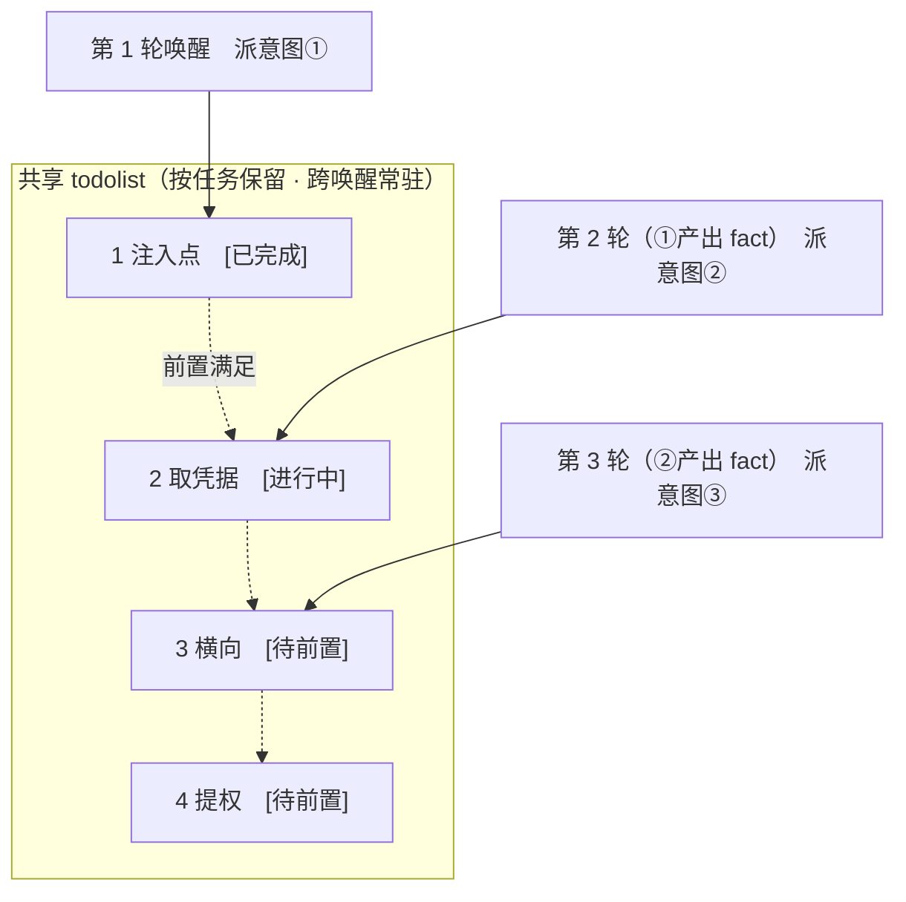

于是攻击链在“事件驱动 + 无状态会话”的环境下依然**稳定推进、不重复、不错序**——这是 ARTEX 能自主走完多步利用链的关键。

---

## 参考

https://github.com/oritera/Cairn

https://github.com/Autumn-27/ARTEX

https://github.com/Xiao1an/ARTEX-God


## 许可与免责声明

### 开源协议

本项目采用 **GNU Affero General Public License v3.0（AGPL-3.0）** 授权，完整条款见仓库根目录的 [LICENSE](LICENSE) 文件。

这意味着任何人都可以自由使用、修改和分发本项目，但**衍生作品必须同样以 AGPL-3.0 开源**；特别地，**若你修改本项目并通过网络（如部署为在线服务）向用户提供，也必须向这些用户公开对应的完整源码**。

> ⚠️ **重要提示**：开源协议本身不限制软件的使用用途。以下的「使用限制」与「免责声明」是作者对使用者的额外约定与郑重声明，请务必遵守。

**ARTEX 仅供个人学习、代码研究与本地技术验证使用，不得用于对任何线上系统或网站发起实际测试。**

### 允许使用范围

- 仅可用于**阅读、学习与研究本项目源码**，以及在**本地隔离环境**中进行技术原理验证；
- 适用于个人学习、学术研究、代码审阅等非攻击性用途。

### 禁止事项

- **严禁使用本工具对任何网站、线上服务或联网系统发起扫描、探测、利用或攻击**（无论是否获得授权、是否为自有资产）；
- 严禁将本工具用于任何实际的渗透测试、攻防对抗或生产环境；
- 严禁将本工具用于非法入侵、数据窃取、勒索、拒绝服务或任何破坏性、犯罪性活动；
- 严禁利用本工具从事违反所在国家/地区法律法规的行为。

### 合规责任

使用者须自行遵守所在国家/地区关于网络安全、数据保护与计算机犯罪的全部法律法规（在中国大陆包括但不限于《网络安全法》《数据安全法》《个人信息保护法》及相关司法解释）。**因使用本工具产生的一切法律责任与后果，均由使用者自行承担。**

### 免责声明

本项目按“现状（AS IS）”提供，不附带任何明示或默示的担保。作者及贡献者不对使用本工具（无论使用方式是否得当）所导致的任何直接或间接损失、数据丢失、系统损坏或法律纠纷承担责任。**下载、安装或使用本项目，即表示你已阅读、理解并同意上述全部条款。**
